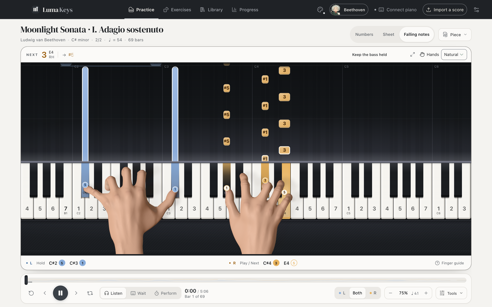
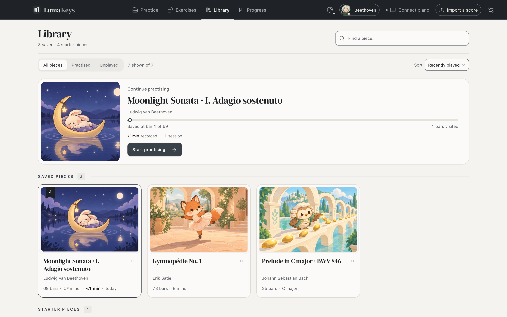
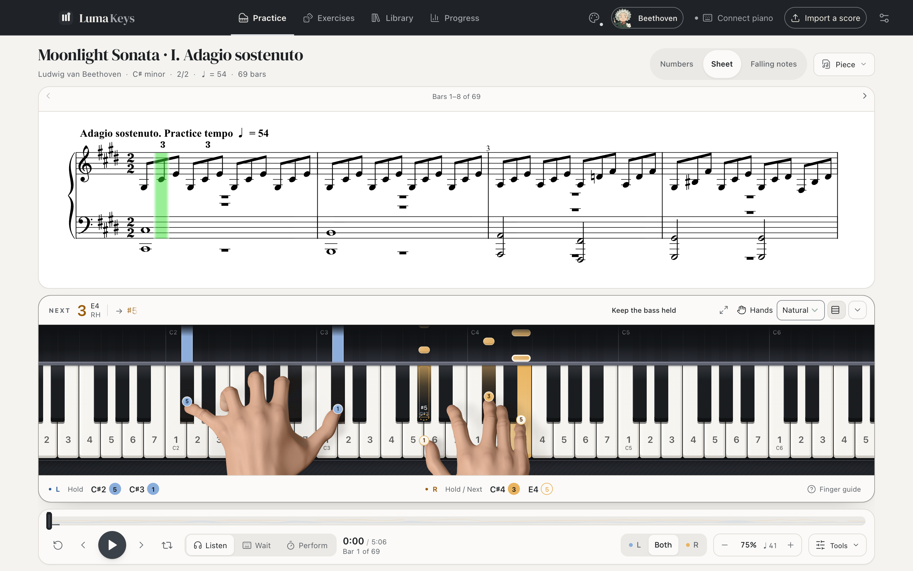
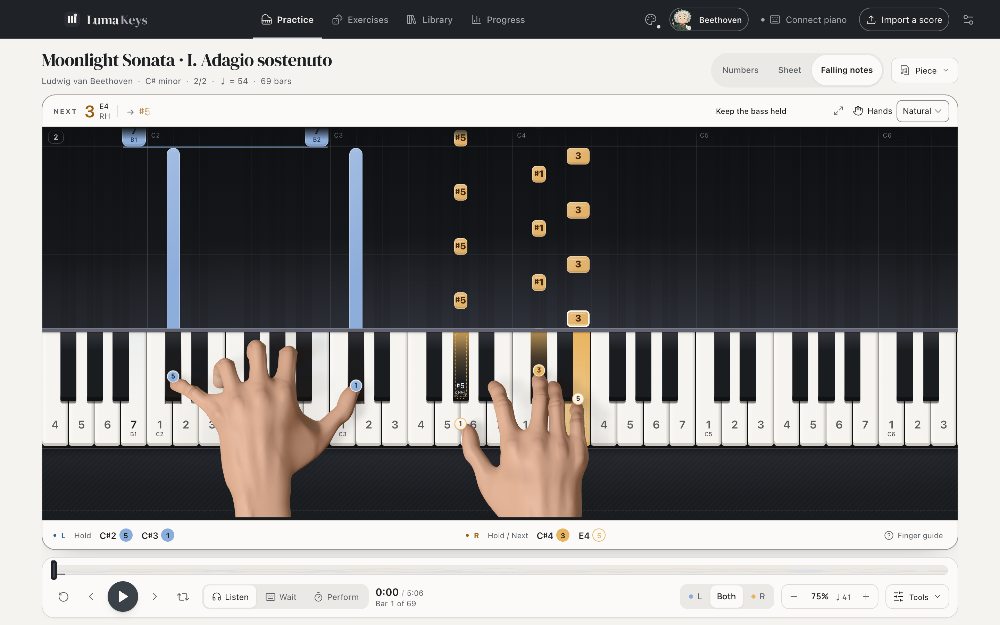
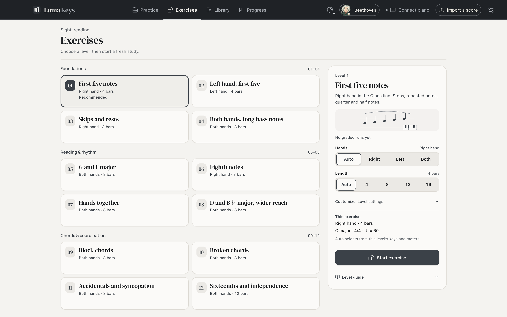

# Luma Keys

A desktop piano practice app for the Mac. Open a score and Luma Keys shows it as a
numbered score, engraved sheet music or falling notes, while a pair of 3-D hands plays
each passage with fingering planned for the whole piece. Then it listens while you play
it back, on a MIDI piano, the computer keyboard or an acoustic piano through the
microphone. It works offline, with no account, no cloud service and no paid API.

[](https://github.com/ult666666/luma-keys/actions/workflows/test.yml)



## Try it

You need Node.js 20.19 or newer (it is developed on Node 24). The development build runs
in the browser:

```bash
git clone --depth 1 https://github.com/ult666666/luma-keys.git
cd luma-keys
npm install
npm run dev
```

Open http://127.0.0.1:5188. The local API listens on port 5189 and keeps scores,
settings and the practice journal in `Library/`, which git ignores. `--depth 1` skips the
full history, which is large. To try it with a throwaway library instead:

```bash
LUMA_DATA_DIR="$PWD/.qa-runs/demo/Library" npm run dev
```

## What it does

Each piece can be read three ways: a numbered score (scale degrees 1 to 7, with durations
and both hands), engraved sheet music with a moving cursor, and a falling-note runway
timed to the audio you hear, output latency included. All three read the same parsed note
timeline, so they always agree.

When a piece opens, Luma Keys plans the fingering for all of it with a dynamic program
over each hand's chords. The cost weighs finger stretch, thumb crossings, black keys, weak
fingers, held notes and the time available to move, after Parncutt et al.'s 1997
ergonomic model. Two rigged 3-D hands, built from Microsoft's Mixed Reality Toolkit
meshes, then play it. Held keys stay under their fingertip, and each hand moves to its
next position before it is needed.

There are three ways to practise. Listen & follow plays a sampled Yamaha C5 grand (six
velocity layers) with phrasing, pedal and room acoustics. Wait for me stops at each note
until you play it, on a MIDI piano, the on-screen keys, the computer keyboard or an
acoustic piano through the microphone. Play in time counts you in, keeps a click and grades every note. A
note counts if it lands within 0.4 beat of the written onset, or 250 ms if that is
longer. It is on time within 0.1 beat, or 100 ms if that is longer.

Exercises generates short original sight-reading pieces at twelve graded levels. Each
comes from a seed and is engraved as MusicXML, so any graded run can be replayed. You can
also import MusicXML, MIDI, Luma JSON or a PDF. PDFs are read on your Mac by Audiveris
optical music recognition, then shown beside the original page in an editor where any
pitch, octave, rhythm or hand can be corrected.

Every judged bar goes into a practice journal. Bars that keep slipping become trouble
spots: they are marked on the piece map and drilled at 70% speed or slower until three
clean passes in a row clear them. Progress shows streaks, a calendar, each piece's
history and graded-run trends.

Six illustrated companions answer practice commands such as "repeat bars 4–8", "slower"
or "where did I stop?", and chat through a language model that llama.cpp runs locally.
Note guidance always comes from the written score, never from the model.

Every save is atomic and flushed to disk. Earlier versions of a score, removed pieces and
daily settings snapshots can be restored. Each major part of the window has its own
error boundary, so a damaged file is set aside instead of taking the Library down.

<table>
  <tr>
    <td width="50%"><br><sub>Library: illustrated covers, a resume card, saved and starter pieces</sub></td>
    <td width="50%"><br><sub>Sheet music: OpenSheetMusicDisplay engraving with a live cursor</sub></td>
  </tr>
  <tr>
    <td width="50%"><br><sub>Falling notes: a runway with bar rules, hand colours and fingering</sub></td>
    <td width="50%"><br><sub>Exercises: twelve seeded sight-reading levels</sub></td>
  </tr>
</table>

## How it is built

Luma Keys is an Electron shell around a React 19 renderer and a local Express API that
keeps the Library on disk. One parser turns MusicXML, MIDI and Luma JSON into a single
note timeline, which every view, the player, the grader and the fingering planner read.
Fingering, 3-D mesh preparation and microphone processing run in workers, and the
optional engines run as separate processes.
[docs/ARCHITECTURE.md](docs/ARCHITECTURE.md) has the diagram, the process boundaries,
good files to start reading and the repository layout.

## Build and test

| Command | What it does |
| --- | --- |
| `npm test` | Runs the unit and API tests (`node --test`) |
| `npm run build` | Builds the renderer into `dist/` |
| `npm start` | Opens the built app in Electron |
| `npm run pack` | Packages `release/mac-arm64/Luma Keys.app` (needs the engines below) |
| `npm run qa:native` | Runs every packaged-app Playwright story in sequence |
| `npm run qa:browser` | Builds and checks five sight-reading stories with an isolated library and a temporary server ([setup](docs/BROWSER_QA.md)) |
| `npm run qa:electron` | Opens the built app in Electron, plays Für Elise for four seconds and checks the song position, the sheet cursor and audio. Set `LUMA_APP` to the packaged app's executable to check a release build |

The optional engines are not in the repository because of their size (about 5.6 GB). Put
them under `engines/` to enable PDF import and companion chat, or to package the app:

| Folder | Contents | Source |
| --- | --- | --- |
| `engines/Audiveris.app` | Audiveris 5.11.0, macOS arm64 | [Audiveris releases](https://github.com/Audiveris/audiveris/releases/tag/5.11.0) |
| `engines/tessdata` | Tesseract `eng.traineddata` 4.1.0 | [tessdata 4.1.0](https://github.com/tesseract-ocr/tessdata/tree/4.1.0) |
| `engines/companion-llm` | `llama-server` and its dylibs (b11146) and `Qwen3.5-9B-Q4_K_M.gguf` | [llama.cpp](https://github.com/ggml-org/llama.cpp) · [Unsloth GGUF](https://huggingface.co/unsloth/Qwen3.5-9B-GGUF) |
| `engines/companion-model` | Swift helper built from [`native/CompanionModel.swift`](native/CompanionModel.swift) | `npm run build:companion` |

`npm test` runs more than 1,000 unit and API tests in [`tests/`](tests). They cover
parsing, fingering, hand posing and contact, motion continuity, the grader, the exercise
generator, storage and recovery, the companion pipeline, microphone matching against
PCM fixtures, and packaging. CI runs them on macOS for every push to `main` and
every pull request. CI also runs the browser sight-reading stories, and it opens the
built app in Electron on Linux under Xvfb
([`scripts/electron-smoke.mjs`](scripts/electron-smoke.mjs)), so an Electron upgrade
from Dependabot is opened, not only installed. The smoke test plays Für Elise and fails
unless the song position advances, the sheet cursor follows the notes and the window
produces audio.

Playwright stories in [`scripts/`](scripts) drive the real UI, in the browser
(`*-qa.mjs`) and in the packaged app (`native-*-qa.mjs`), against isolated test
libraries. They cover input, reading, phrase practice, sight reading, recovery, quitting
while saving and recognition shutdown. Each release records its checks in [`evidence/`](evidence), and
[`STATUS.md`](STATUS.md) is the build log.

The [user guide](docs/USER_GUIDE.md) covers every screen and control, with release notes,
newest first. [PLAN.md](PLAN.md) has the plan for each version, and there is a design
note per feature, for example [hand motion](docs/HAND_MOTION_DESIGN.md),
[trouble spots](docs/TROUBLE_SPOTS_2.40.md), [solid storage](docs/SOLID_STORAGE_2.41.md),
[microphone Wait](docs/MICROPHONE_WAIT_2.34.md), [the concert piano](docs/CONCERT_PIANO_2.12.md)
and [the local companion](docs/COMPANION_INTELLIGENCE_2.20.md).

## Limits

- The packaged app targets macOS on Apple silicon; the browser development build runs
  wherever Chrome does.
- PDF import and free-form chat need the optional engines, which are not in the
  repository.
- The microphone detector can mistake a note's overtones for an extra octave and has not
  been tested with real acoustic pianos and rooms; use MIDI when every key must be checked.
- Recognised PDFs need a review pass, and repeats and navigation marks play once, in
  written order.
- Companion chat runs a local model, so first replies can be slow and its language and
  facts vary.

Built with AI coding assistants. The tests and CI checks described above verify its
behaviour.

## Credits

Full attribution and licence texts are in
[docs/THIRD_PARTY_NOTICES.md](docs/THIRD_PARTY_NOTICES.md).

- Salamander Grand Piano V3 by Alexander Holm (CC BY 3.0). FLAC remapping by kinwie, via [sfzinstruments](https://github.com/sfzinstruments/SalamanderGrandPiano).
- FluidR3_GM guitar and bass samples via [midi-js-soundfonts](https://github.com/gleitz/midi-js-soundfonts) (CC BY 3.0).
- Rigged hand meshes from Microsoft's [Mixed Reality Toolkit](https://github.com/microsoft/MixedRealityToolkit-Unity) (MIT).
- Scores from the [Mutopia Project](https://www.mutopiaproject.org/) (public domain and CC BY-SA 2.5), with provenance beside each file.
- [OpenSheetMusicDisplay](https://opensheetmusicdisplay.org/) (BSD-3), [PDF.js](https://mozilla.github.io/pdf.js/) (Apache-2.0), [three.js](https://threejs.org/) (MIT), [Audiveris](https://github.com/Audiveris/audiveris) (AGPL-3.0, separate process), [llama.cpp](https://github.com/ggml-org/llama.cpp) (MIT) and [Qwen 3.5](https://huggingface.co/Qwen/Qwen3.5-9B) (Apache-2.0).
- Fonts: Manrope and DM Serif Display (SIL OFL 1.1).

The companions are original stylized characters. The composer and pianist portraits are
affectionate tributes, not likenesses endorsed by anyone. Copyrighted arrangements the
author practises privately are not included in this repository.

## License

© 2026 Charles Dai. Luma Keys' own code and artwork are released under the
[MIT License](LICENSE). Bundled third-party samples, models, fonts and scores keep their
own licences.
