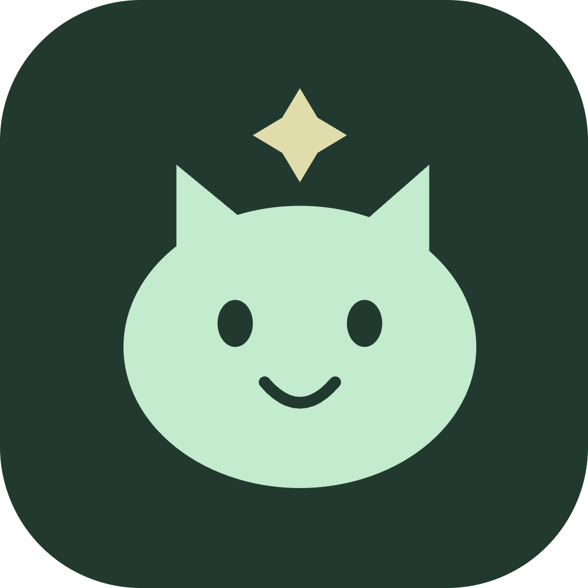
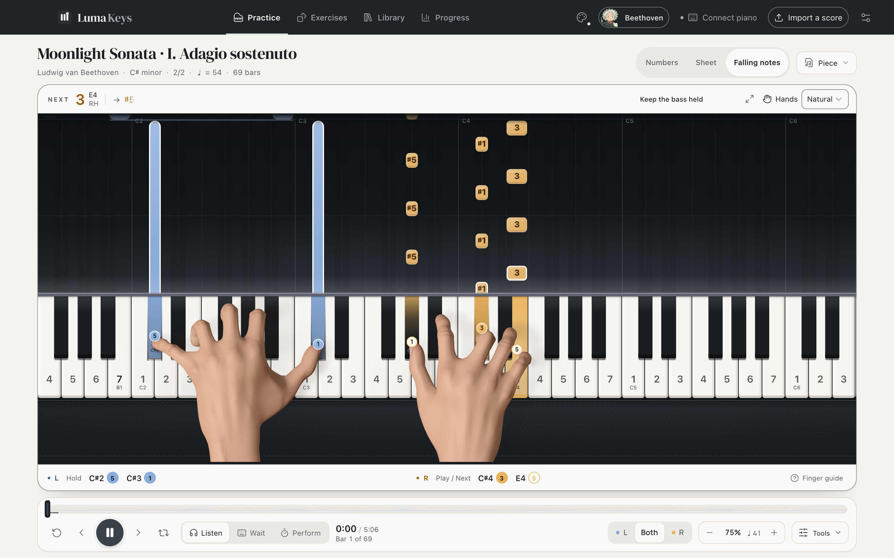
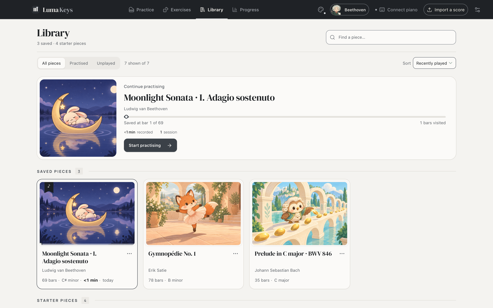
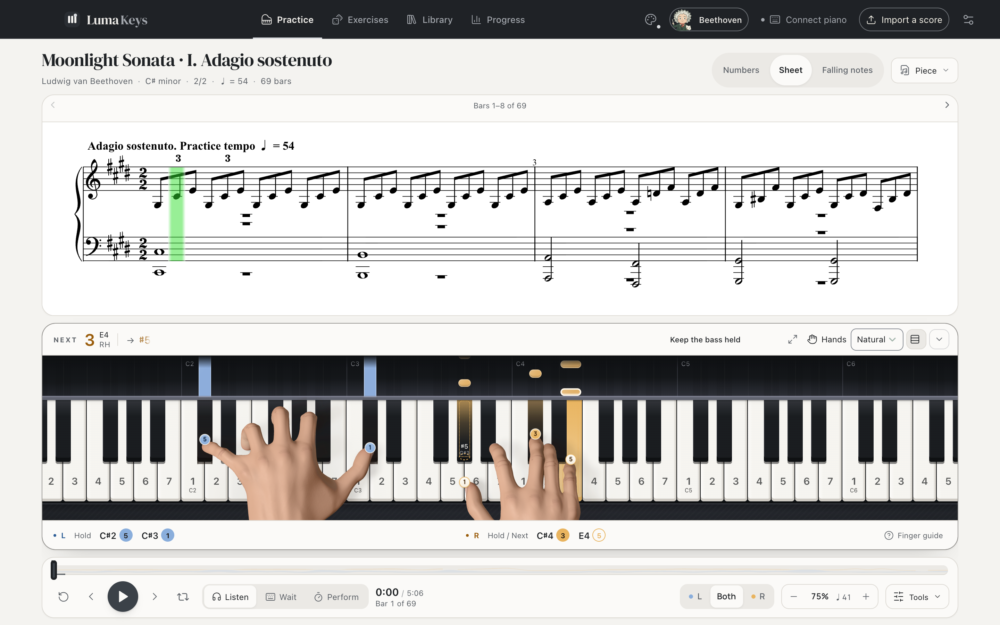
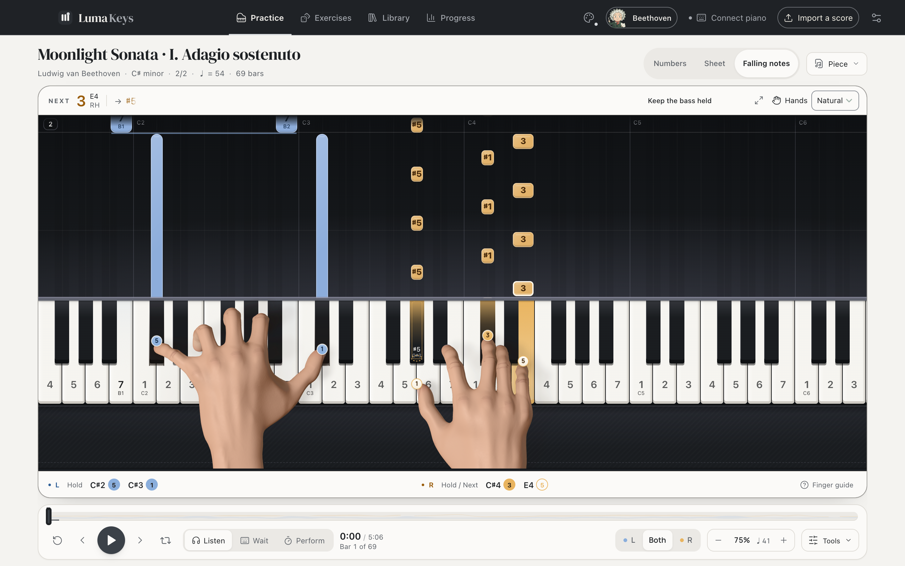
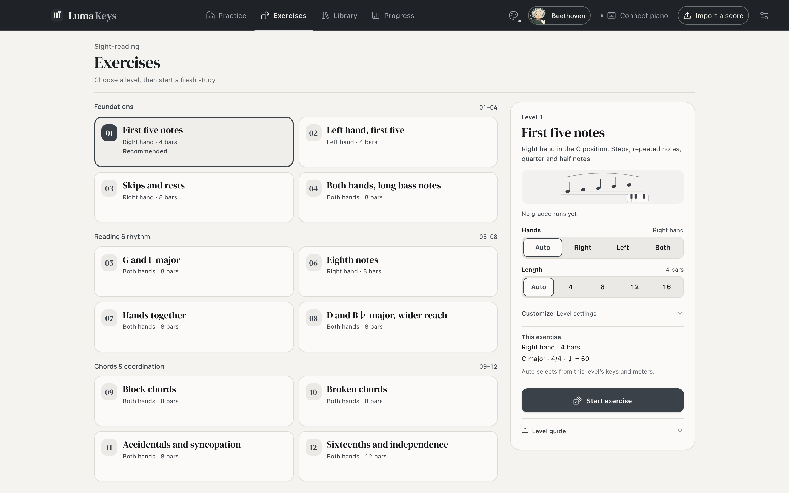
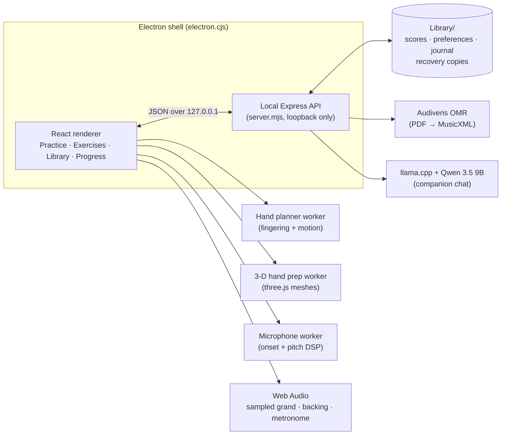

<div align="center">



# Luma Keys

**An offline piano practice studio for reading music, with animated hands that show you how to play it.**

Open a score, and Luma Keys turns it into a numbered score, engraved sheet music and a falling-note runway. The fingering for the whole piece is planned up front, and a pair of 3-D hands plays each passage on the keyboard. Then it listens for you to play it back.

Everything runs locally on your Mac: no account, no cloud service, no paid API.

[](https://github.com/ult666666/luma-keys/actions/workflows/test.yml)

<sub>Electron · React 19 · Vite · Express · three.js · OpenSheetMusicDisplay · PDF.js · Web Audio · Web MIDI · llama.cpp</sub>

</div>

<p align="center">
  
</p>

## Highlights

- **Three ways to read one piece.** A numbered score (1–7 by scale degree, with durations and both hands), engraved sheet music with a moving cursor, and a falling-note runway timed to the audio you hear, latency included. They all read the same parsed note timeline, so they always agree.
- **Hands that show the fingering.** The fingering for the whole piece is planned when it opens, using a dynamic program over each hand's chords that weighs finger-pair stretch, thumb crossings, black keys, weak fingers, held notes and the time available to move (after Parncutt et al.'s 1997 ergonomic fingering model). Two skinned 3-D hands (Microsoft MRTK meshes) then play it. Held keys stay under their fingertip, and the hand glides to its next position before it is needed.
- **Three practice modes.** *Listen & follow* plays a sampled Yamaha C5 grand (six velocity layers, lossless FLAC) with phrasing, pedal and room acoustics. *Wait for me* waits at each note until you play it on a MIDI piano, the on-screen keys, the computer keyboard or, through the microphone, an acoustic piano. *Play in time* counts you in, keeps a click and grades every note. A note counts if it lands within 0.4 beat (at least 250 ms) of the written onset, and is on time within 0.1 beat (at least 100 ms).
- **New sight-reading music every time.** Twelve graded levels generate short original pieces from a seed, engraved as real MusicXML. The same seed always gives the same piece, so any graded run can be replayed exactly.
- **Bring your own scores.** Import MusicXML, MIDI, Luma JSON or a PDF. PDFs are read on-device by Audiveris optical music recognition, then shown beside the original page in a review editor where any pitch, octave, rhythm or hand can be corrected.
- **It remembers where you struggle.** Every judged bar goes into a practice journal. Bars that keep slipping become *trouble spots*, marked on the piece map and drilled at 70% speed until three clean passes clear them. Progress shows streaks, a calendar, per-piece history and graded-run trends.
- **A companion coach.** Six illustrated companions answer practice commands ("repeat bars 4–8", "slower", "where did I stop?") and chat through a local Qwen 3.5 9B model served by llama.cpp. Exact note guidance always comes from the written score, never from the model.
- **Built not to lose your work.** Every save is atomic and flushed. Earlier versions of scores, removed pieces and daily settings snapshots can be restored. Each major part of the window has its own error boundary, and a damaged file is isolated instead of taking the Library down.

<table>
  <tr>
    <td width="50%"><br><sub><b>Library</b>: illustrated covers, resume card, saved and starter pieces</sub></td>
    <td width="50%"><br><sub><b>Sheet music</b>: OpenSheetMusicDisplay engraving with a live cursor</sub></td>
  </tr>
  <tr>
    <td width="50%"><br><sub><b>Falling notes</b>: runway with bar rules, hand colours and fingering</sub></td>
    <td width="50%"><br><sub><b>Exercises</b>: twelve seeded sight-reading levels</sub></td>
  </tr>
</table>

## How it works



- **One music model.** `src/music.mjs` parses MusicXML, MIDI and Luma JSON into a single note timeline: bars, meters, tempo changes, pickups, ties, pedal and dynamics. Every view, the player, the grader, the fingering planner and the exports read that timeline.
- **The renderer has no Node access.** The Electron window is sandboxed and talks only to the loopback API, which rejects foreign origins. The packaged app picks its own free port.
- **Heavy work stays off the main thread.** Fingering and hand motion are planned in a worker for the whole piece. Mesh preparation and microphone DSP have workers of their own. The 3-D renderer loads only when hands are first shown.
- **Optional engines run as separate processes.** Audiveris (AGPL-3.0) and llama.cpp are launched unmodified as child processes and stopped when the app quits. Without them, PDF import and free-form chat are unavailable and everything else works.

The source is in [`src/`](src): React screens, ES modules and CSS. Some good entry points: [`fingering.mjs`](src/fingering.mjs), [`hand3d-rig.mjs`](src/hand3d-rig.mjs), [`exercise.mjs`](src/exercise.mjs), [`performance.mjs`](src/performance.mjs), [`trouble-spots.mjs`](src/trouble-spots.mjs), [`microphone-detector.mjs`](src/microphone-detector.mjs) and [`atomic-file.mjs`](src/atomic-file.mjs).

## Getting started

You need Node.js 20.19 or newer (developed on Node 24). The packaged desktop build targets macOS on Apple silicon. The browser development build runs anywhere Chrome does.

```bash
git clone --depth 1 https://github.com/ult666666/luma-keys.git
cd luma-keys
npm install
npm run dev
```

`--depth 1` downloads only the latest commit instead of the full history, which is large.

Open http://127.0.0.1:5188. The API listens on port 5189 and keeps its data in `Library/` (git-ignored). To use a throwaway library instead, set `LUMA_DATA_DIR`:

```bash
LUMA_DATA_DIR="$PWD/.qa-runs/demo/Library" npm run dev
```

| Command | What it does |
| --- | --- |
| `npm test` | Runs the unit and API tests (`node --test`) |
| `npm run build` | Builds the renderer into `dist/` |
| `npm start` | Opens the built app in Electron |
| `npm run pack` | Packages `release/mac-arm64/Luma Keys.app` (needs the engines below) |
| `npm run qa:native` | Runs every packaged-app Playwright story in sequence |
| `npm run qa:browser` | Builds and verifies five sight-reading stories with an isolated library and ephemeral server ([setup and evidence](docs/BROWSER_QA.md)) |

### Optional engines

These are left out of the repository because of their size (about 5.6 GB). Put them under `engines/` to enable PDF import and companion chat, or to package the app:

| Folder | Contents | Source |
| --- | --- | --- |
| `engines/Audiveris.app` | Audiveris 5.11.0, macOS arm64 | [Audiveris releases](https://github.com/Audiveris/audiveris/releases/tag/5.11.0) |
| `engines/tessdata` | Tesseract `eng.traineddata` 4.1.0 | [tessdata 4.1.0](https://github.com/tesseract-ocr/tessdata/tree/4.1.0) |
| `engines/companion-llm` | `llama-server` and its dylibs (b11146) and `Qwen3.5-9B-Q4_K_M.gguf` | [llama.cpp](https://github.com/ggml-org/llama.cpp) · [Unsloth GGUF](https://huggingface.co/unsloth/Qwen3.5-9B-GGUF) |
| `engines/companion-model` | Swift helper built from [`native/CompanionModel.swift`](native/CompanionModel.swift) | `npm run build:companion` |

## Testing and verification

- **More than 1,000 unit and API tests** in [`tests/`](tests) cover parsing, fingering, hand posing and contact, motion continuity, the grader, the exercise generator, storage and recovery, the companion pipeline, microphone matching against PCM fixtures, and packaging. CI runs them on macOS for every push to `main` and every pull request.
- **Playwright stories** in [`scripts/`](scripts) drive the real UI, both in the browser (`*-qa.mjs`) and in the packaged Electron app (`native-*-qa.mjs`), against isolated test libraries. They cover input, reading, phrase practice, sight reading, recovery, quit-while-saving and recognition shutdown.
- **Evidence.** Every release pass records its verification JSON and screenshots in [`evidence/`](evidence). [`STATUS.md`](STATUS.md) is the candid build log, known limitations included.

## Repository layout

```
src/              React UI, music model, audio, hands, companion, storage
  screens/        Exercises, Library, Progress and companion screens
server.mjs        Local API: library, imports, recognition, companion runtime
electron.cjs      Desktop shell, sandboxing, engine lifecycle
tests/            node:test suites and fixtures
scripts/          Playwright QA stories, asset builders, hand-motion lab
public/           Piano and backing samples, hand models, fonts, PDF.js, cover art
Practice Sheets/  Starter sheets and three public-domain / CC classics
Assets/           Icon, companion and cover artwork sources
docs/             User guide, per-version design notes, third-party notices
evidence/         Verification output and screenshots from each release
```

## Documentation

- [User guide and release notes](docs/USER_GUIDE.md): every screen and control, newest changes first.
- [STATUS.md](STATUS.md) and [PLAN.md](PLAN.md): the build log and plan for each version pass.
- Design notes, one per feature pass, for example [hand motion](docs/HAND_MOTION_DESIGN.md), [trouble spots](docs/TROUBLE_SPOTS_2.40.md), [solid storage](docs/SOLID_STORAGE_2.41.md), [microphone Wait](docs/MICROPHONE_WAIT_2.34.md), [the concert piano](docs/CONCERT_PIANO_2.12.md) and [the local companion](docs/COMPANION_INTELLIGENCE_2.20.md).

## Credits

Luma Keys stands on generous open work. Full attribution and licence texts are in [docs/THIRD_PARTY_NOTICES.md](docs/THIRD_PARTY_NOTICES.md).

- **Salamander Grand Piano V3** by Alexander Holm (CC BY 3.0). FLAC remapping by kinwie, via [sfzinstruments](https://github.com/sfzinstruments/SalamanderGrandPiano).
- **FluidR3_GM** guitar and bass samples via [midi-js-soundfonts](https://github.com/gleitz/midi-js-soundfonts) (CC BY 3.0).
- **Rigged hand meshes** from Microsoft's [Mixed Reality Toolkit](https://github.com/microsoft/MixedRealityToolkit-Unity) (MIT).
- **Scores** from the [Mutopia Project](https://www.mutopiaproject.org/) (public domain and CC BY-SA 2.5), with provenance beside each file.
- [OpenSheetMusicDisplay](https://opensheetmusicdisplay.org/) (BSD-3), [PDF.js](https://mozilla.github.io/pdf.js/) (Apache-2.0), [three.js](https://threejs.org/) (MIT), [Audiveris](https://github.com/Audiveris/audiveris) (AGPL-3.0, separate process), [llama.cpp](https://github.com/ggml-org/llama.cpp) (MIT) and [Qwen 3.5](https://huggingface.co/Qwen/Qwen3.5-9B) (Apache-2.0).
- Fonts: Manrope and DM Serif Display (SIL OFL 1.1).

The companions are original stylized characters. The composer and pianist portraits are affectionate tributes, not likenesses endorsed by anyone. Copyrighted arrangements the author practises privately are not included in this repository.

---

<sub>© 2026 Charles Dai. Luma Keys' own code and artwork are released under the [MIT License](LICENSE). Bundled third-party samples, models, fonts and scores keep their own licences.</sub>
