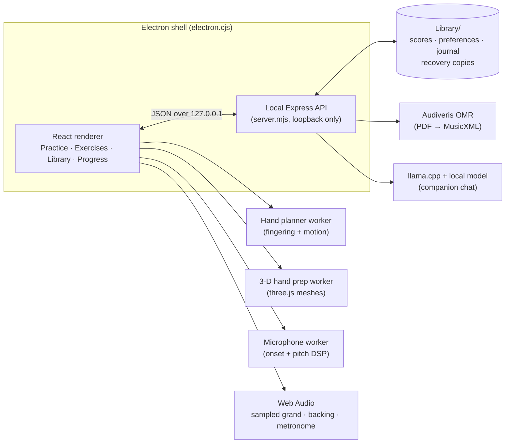

# Architecture

Luma Keys is built with Electron, React 19, Vite, Express, three.js,
OpenSheetMusicDisplay, PDF.js, Web Audio, Web MIDI and llama.cpp. Back to the
[README](../README.md).



The app is an Electron shell around a React 19 renderer (built with Vite) and a local
Express API. The renderer is sandboxed with no Node access and talks only to the API,
which rejects foreign origins; the packaged app picks its own free port. `src/music.mjs`
parses MusicXML, MIDI and Luma JSON into one note timeline with bars, meters, tempo
changes, pickups, ties, pedal and dynamics. Every view, the player, the grader, the
fingering planner and the exports read that timeline.

Fingering and hand motion are planned for the whole piece in a worker, and mesh
preparation and microphone signal processing have workers of their own. The 3-D renderer
(three.js) loads only when hands are first shown. Audiveris and llama.cpp run unmodified
as child processes and stop when the app quits; without them, PDF import and free-form
chat are unavailable and everything else works.

Good places to start reading: [`fingering.mjs`](../src/fingering.mjs),
[`hand3d-rig.mjs`](../src/hand3d-rig.mjs), [`exercise.mjs`](../src/exercise.mjs),
[`performance.mjs`](../src/performance.mjs), [`trouble-spots.mjs`](../src/trouble-spots.mjs),
[`microphone-detector.mjs`](../src/microphone-detector.mjs) and
[`atomic-file.mjs`](../src/atomic-file.mjs).

## Repository layout

```
src/              React UI, music model, audio, hands, companion, storage
  screens/        Exercises, Library, Progress and companion screens
server.mjs        Local API: library, imports, recognition, companion runtime
electron.cjs      Desktop shell, sandboxing, engine lifecycle
tests/            node:test suites and fixtures
scripts/          Playwright QA stories, asset builders, hand-motion lab
public/           Piano and backing samples, hand models, fonts, PDF.js, cover art
Practice Sheets/  Starter sheets and three public-domain / CC classics
Assets/           Icon, companion and cover artwork sources
docs/             User guide, per-version design notes, third-party notices
evidence/         Verification output and screenshots from each release
```
