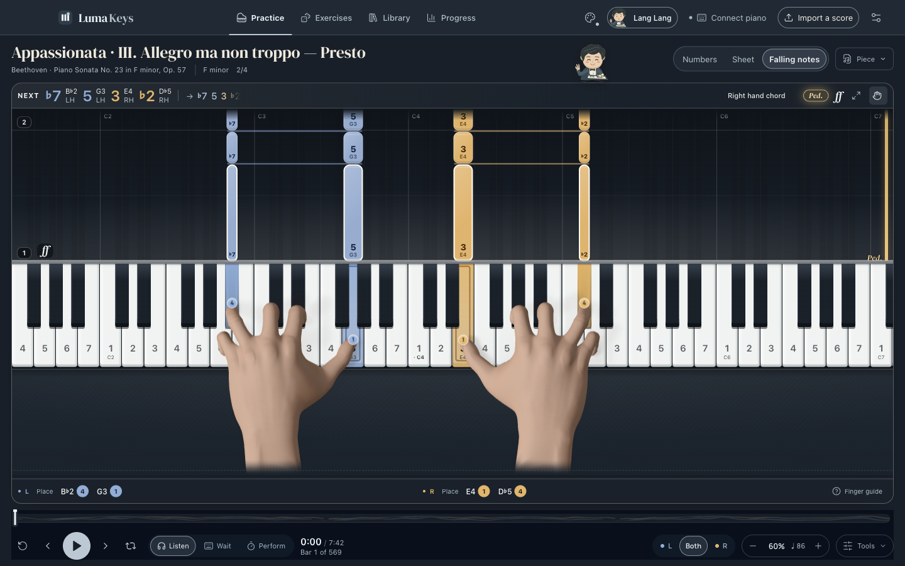
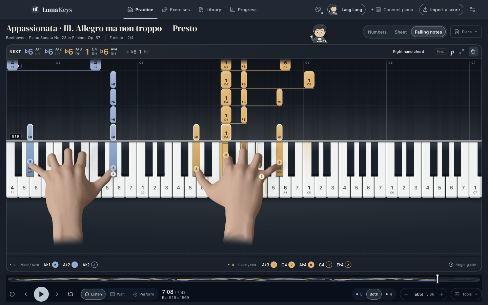

# Hand guide 2.36

The old guide had a long, flat palm, a stretched thumb web and straight idle fingers. This update replaces the actual rigged mesh, preserves its bone proportions, and uses a more compact playing posture. Curved resting fingers, a clearer thumb joint and restrained knuckle shading improve the visible hand rather than only its contact markers.

The runtime asset is Microsoft MRTK’s MIT-licensed RiggedHandVisualizer, converted reproducibly to the app’s hand format. Source, license and conversion provenance are retained in `Assets/hands/mrtk/`; shipped provenance is beside the two GLBs. Exact-attribute indexing reduces each model from about 488 KB to 115 KB without changing triangles, normals, UV seams or weights. Runtime subdivision and skin-map baking now share the same geometry settings and model hashes.

The posing fixes remove a synthetic 40 ms overlap when it would make two long fingers cross, preserving written note lengths and legitimate thumb-under transitions. Bounded wrist refinement now samples inward at angular limits and solves the remaining movable coordinates. Thumb-under crossings can turn the wrist to 22 degrees; source bone proportions and finger joint limits remain intact.

The forearm now fades in the hand’s own coordinates before the mesh ends. This keeps raised coda poses from exposing a flat cut edge.

## Verification

All 100 hand motion/rig tests pass, along with 40 focused coach, planner, keyboard, seek and packaging tests and the added forearm-fade regression. Ordinary active contacts retain a 0.5 mm test tolerance; difficult transitions retain 2 mm. Final native-app results and installation identity are recorded in the accompanying verification evidence.

The generated [anatomy study](design/pianist-study-2.36.png) was a visual reference, not the runtime hand asset. The image-generation prompt and tool output are retained in `.qa-runs/hand-sculpt-2.36/art-reference.json`.

These checks cover the tested scores, poses and layouts. They do not establish perfect hand placement for every score or prescribe professional fingering. This update makes no new physical-piano recognition or audio-quality claim.

## Frame pacing

A sequential comparison on this Mac showed variable frame pacing in both 2.35 and the new model, including runs with hands hidden. In two six-second hands-visible samples, 2.35 produced 170/214 frames and the first 2.36 candidate produced 239/150. Hand-update CPU averages were 7.73/6.37 ms and 5.78/6.64 ms respectively. This does not demonstrate a consistent hand-rendering slowdown, but it also does not establish locked 60 fps. No speculative solver optimization was shipped. The final build’s own playback sample is retained in the native report.

## Installed result

Version 2.36.0 was installed and reopened on the Desktop. All 3,035 bundle entries match the accepted native-tested package; 107 personal musical/settings files were unchanged. Actual window pixels confirm the new hands and the saved practice setup. The first inspection timed out during launch; the subsequent native window and screenshot succeeded.

